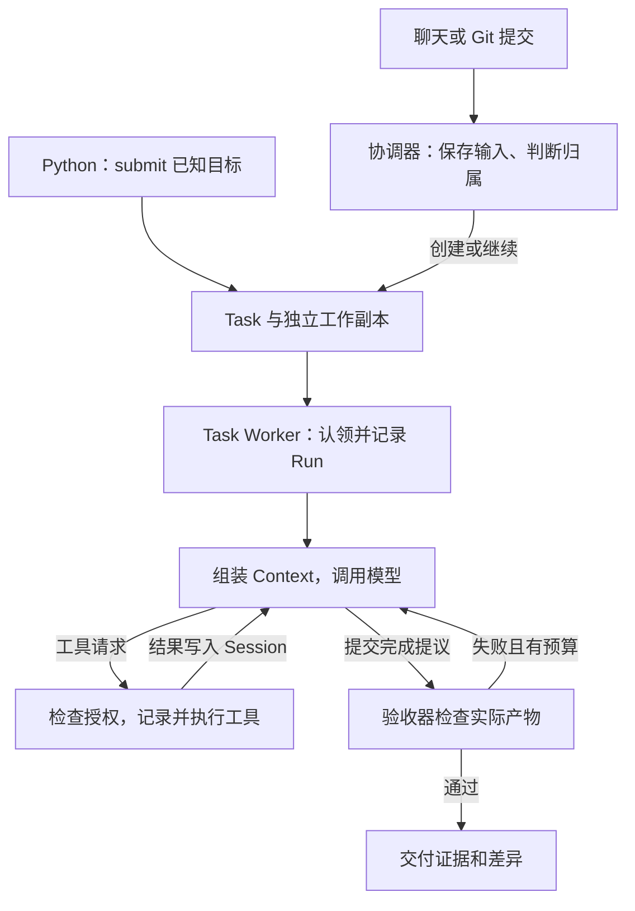

# DemoHarness 系统设计

这份文档统一记录能力范围、架构和验收状态。决定按最后一次明确确认的讨论更新。

DemoHarness 面向一位使用者学习本机 Agent 的执行过程。一个 Python 进程运行多个相互隔离的 Agent，CLI 和 Python API 共用一个运行时及 SQLite 状态库。进程停止期间暂停推进，重启后核对已有结果。首版交付工作副本内的变更和验收证据，由使用者决定如何合入。

## 一次工作怎样完成

以[文件示例](../examples/verified_task.py)为例，目标是生成 `report.md` 并逐字验收。Python 的 `Agent.submit()` 直接提交目标和验收条件。聊天消息或 Git 观察先经协调器，判断是回复、继续已有 Task、创建新 Task，还是请求澄清。

每个 Task 同时最多一个 Worker。A 等模型、Git 或文件检查时，运行时仍能收消息并推进 B。阻塞的工作副本操作交给线程池，SQLite 状态由事件循环更新。同一件事的补充落盘后，Worker 会在动作边界读取。已开始动作的结果留在历史，过时的待执行动作和验收结果会跳过。完成后的明确跟进继续同一个 Task，保留历史和之前的交付。

## 角色和状态归属

| 概念 | 职责 |
|---|---|
| Agent 定义 `AgentDefinition` | 稳定 ID、项目、身份与行为说明、模型及工具授权。CLI 可从 `SOUL.md`、`AGENTS.md` 读取提示。 |
| Agent 运行时 `AgentRuntime` | 本机宿主，打开状态库，装配协调器、观察器、模型和 Worker。 |
| Agent 实例 `Agent` | `runtime.agent(id)` 返回的操作入口。Task、协调记录、工作目录和长期记忆按 Agent ID 隔离。 |
| Task Worker | 推进一个 Task 的协程。运行结束后，Task、Session 和证据继续保存在 SQLite。 |
| Task 与 Session | Task 是一件事，保存目标、验收、状态、预算、Plan 和工作副本。Session 持久记录这件事的输入、工具动作、计划修订及交付。两者一一对应，共用 ID。 |
| Plan | Task 的有序步骤，带版本、稳定步骤 ID、状态和证据引用。调用 `set_plan` 或 `mark_step` 时传入当前版本，过期的更新会被拒绝。修订保留移除步骤的 ID 和证据，并把它们标为退役。Session 保存每次变更及原因。 |
| Run 与工具动作 | Run 记录一次执行尝试的 ID、起止和停止原因。同一 Task 可以有多次 Run。工具动作有稳定 ID，便于恢复时核对。 |
| Context | 每次调用模型前按目标、Plan、验收、Session 片段和相关记忆组装。压缩保留完整的近期工具轮次，原始历史可查。 |
| 临时子 Agent | 承接父 Task 的只读调查或改动建议。使用独立上下文，可按页查父 Session。共享父预算和停止信号，回传结论和证据。实例结束后仍能按委派 ID 查看记录。 |
| 长期记忆 | 归 Agent 所有，作用范围可限定到项目。记录偏好、项目事实或约束、可复用经验，并保留来源和时效。 |

协调、Task Worker 与临时委派的分工参考 [DeepSeek Super Agent 的领域模型](https://github.com/deepseek-ai/dsh-superagent-prototype/blob/8c32a9dc5d72c033816c6a8110b37f40cf94fba4/docs/001-domain.md)。协调器判断归属，Task Worker 和子 Agent 共用 `run_loop()`，各自使用适用的工具、上下文和完成条件。

## 执行、验收和恢复

**工作副本与权限。** Git 用已记录提交创建 worktree，普通目录使用独立副本。Task 持久保存允许写入的相对文件路径，工具执行前核对路径，交付时再检查副本相对基线的文件变化。Python 的 `submit()` 用 `allowed_write_paths` 授权写入，`FileCheck` 只指定验收条件。指定 Task 的 `send()` 可替换范围，传空集合可撤销全部写权限。聊天可用 `授权写入：路径 | 任务说明` 给新 Task 授权一个文件，也可用 `/allow TASK PATH...` 扩大已有 Task 的范围。旧 Task 的历史交付可查，缺少授权记录时需要明确授权后才能写入。首版提供类型化的文件、文本和静态 Python 语法检查。

**执行与交付。** 宿主给模型、工具、压缩和验收设预算，开始新动作前检查权限、额度和停止信号。模型给出的最终文本进入验收。验收通过才保存完成记录、检查证据和差异，失败可在剩余预算内纠正。无法验收的结果进入等待。主动停止会持久化，重启后保持停止。

**中断恢复。** 工具动作依次记录 `pending`、`started`、`result`。文件写入在开始前保存原指纹和目标指纹，启动时先恢复持久记录，再决定是否推进。主动停止或关闭宿主时，会等已经启动的阻塞操作退出再释放运行资源。

| 中断后看到什么 | 恢复动作 |
|---|---|
| 动作尚未开始 | 检查最新输入、权限和预算，再执行或跳过。 |
| 已有结果，或文件已匹配目标指纹 | 复用结果，或按原动作 ID 补记。 |
| 结果缺失，仍匹配原指纹 | 权限和预算允许、且没有新要求替代旧动作时，可以重试。 |
| 文件与原指纹和目标指纹都不符 | 等待核对。 |

## 记忆与主动发现

阶段检查、Run 结束或宿主重启后，运行时按 Session 中的证据提炼记忆。用户可用 `项目事实：名称 = 内容` 或 `项目约束：名称 = 内容` 记录项目知识，明确的用户偏好也可即时保存。完成的 Plan 决策可成为候选，引用了实际通过检查的步骤可形成经验。召回只选该 Agent 少量相关的有效条目，附上来源和时间。失效条目退出召回并可归档清理，用户可查看、更正和删除记忆。原始 Session 历史有自己的保留边界。

Git 项目默认观察源仓库已提交的快照。启动时读取有限基线，之后根据 HEAD 变化评估。变更文件的路径、模式和前后 Git 对象 ID 与已有交付的指纹一致时，运行时将观察关联到原 Task。模型看到的差异摘要可以截断，指纹使用单独的变更元数据。其他变更由协调器判断忽略、关联或创建。观察以项目和提交去重，新工作以问题键关联。Task 变更、去向、问题键和通知在同一 SQLite 事务中提交。默认观察任务可读取和运行内置检查。项目明确启用 `proactive_writes` 时，新观察任务可以写入其验收项指定的文件。关联观察时保留用户的停止决定。

## 对照源码和验证

| 想看什么 | 源码入口 | 可复现的场景 |
|---|---|---|
| 任务怎样分派和执行 | [运行时](../src/demoharness/runtime.py) · [共用循环](../src/demoharness/core/loop.py) · [文件验收](../src/demoharness/tools/files.py) | `uv run python examples/verified_task.py` |
| 怎样在中断后辨认工具结果 | [TaskStore](../src/demoharness/core/storage.py) · [文件指纹](../src/demoharness/tools/files.py) | `uv run pytest -q tests/test_agent_runtime.py -k crash`，使用 `SIGKILL` |
| 怎样收补充、限制文件范围和修订 Plan | [协调器](../src/demoharness/coordination.py) · [文件工具](../src/demoharness/tools/files.py) · [Plan](../src/demoharness/core/plan.py) | `uv run pytest -q tests/test_task_scope_plan.py` |
| 怎样委派、召回记忆和发现工作 | [委派](../src/demoharness/tools/delegation.py) · [Session 投影](../src/demoharness/core/session.py) · [记忆](../src/demoharness/memory.py) · [Git 观察](../src/demoharness/discovery.py) | `uv run python examples/super_agent_demo.py`，结尾验证正常重启后保留状态 |

Python API 的主要入口是 `AgentRuntime.open()`、`runtime.agent()`，以及 Agent 的 `send()`、`submit()`、`history()`、`stop()` 和 `resume()`。CLI 操作见[示例索引](../examples/README.md)。新状态保存在 `agent.sqlite3`，早期会话树和旧数据库可留在原处。

## 验收状态

教学示例和本地 OpenAI 兼容接口已验证。外部模型验收待配置 `OPENAI_API_KEY` 后执行 `uv run python examples/verified_task.py --live`，核对实际文件、验收证据和 Git 差异。
