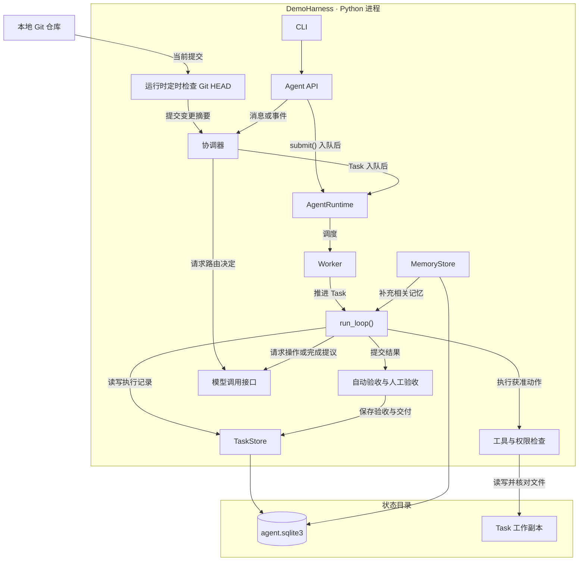
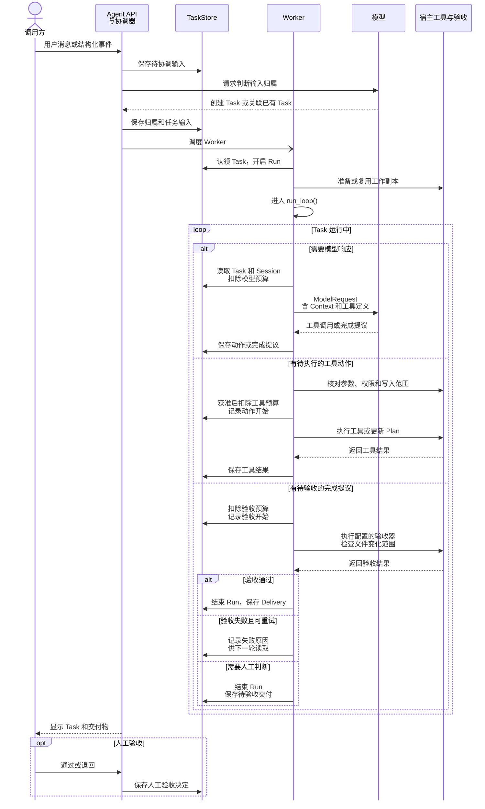

# DemoHarness 架构总览

DemoHarness 是一个通用任务型 Agent 教学产品。学习者可以在 CLI 交代任务、输入事件、查看动态工作流并验收交付。Python API 使用同一个运行时，也提供接入工具和验收器的接口。

## 产品行为

- **接受工作。** Agent 可以从消息或事件中判断是否创建 Task、为已有 Task 补充信息，或直接回复、澄清、忽略。明确的目标也可以通过 `Agent.submit()` 直接提交。
- **自主推进。** 一个 Task 有一份可修订的步骤清单，代码中叫 `Plan`。清单记录 Agent 当前怎样分解工作。Agent 自己决定下一步动作，并根据工具结果和新输入调整后续计划。目标和验收条件由明确指令更新。工具和写入权限由宿主事先配置。
- **提交交付。** 宿主运行已经配置的验收器。检查失败且有额度时，Agent 收到反馈继续修正。需要人工判断的结果会保存为待验收交付，使用者可以通过或退回修改。

SQLite 保存 Task、Session 和记忆。一个 Agent 可以同时推进多件事，同一个 Task 同时最多由一个 Worker 推进。文件产物留在 Task 工作副本里。

## 项目架构

普通消息和 `Agent.receive_event()` 进入同一个协调入口。已知 Task ID 时，可用 `Agent.send(..., task_id=...)` 直接补充要求。关联到执行中的 Task 后，Worker 会在动作边界重新检查最新输入，Agent 据此决定是否修订步骤清单。 [消息如何找到 Task](super-agent.md#消息如何找到-task)

Git 提交是 Super Agent 主动发现工作的入口。运行时默认每隔 5 秒读取本地仓库当前指向的提交（`HEAD`）。发现提交变化后，运行时记录变更证据，协调器再决定创建 Task、关联已有 Task 或忽略。 [Git 提交如何变成工作](super-agent.md#git-提交如何变成工作)

Worker 管理一次 Run，主 Task 和只读子 Agent 共用 `run_loop()`。模型调用接口由 `AgentDefinition.complete` 提供，可以接可控模型或 OpenAI 兼容适配器。协调日志、Task 执行记录和长期记忆共用 `agent.sqlite3`。工作副本以源项目的 Git 提交或目录快照为基线。协调、Worker 与临时委派的分工参考了 DeepSeek Super Agent 的领域模型。 [执行循环](../src/demoharness/core/loop.py) · [DeepSeek 领域模型](https://github.com/deepseek-ai/dsh-superagent-prototype/blob/8c32a9dc5d72c033816c6a8110b37f40cf94fba4/docs/001-domain.md)

## 先认清几个抽象

| 概念 | 职责和归属 |
| --- | --- |
| Agent 定义 | `AgentDefinition` 保存稳定 ID、所属项目、身份提示、模型入口和工具权限。CLI 可以读取 Agent 目录下的 `SOUL.md` 和 `AGENTS.md` 作为提示。 |
| Agent 实例 | `runtime.agent(id)` 返回的操作入口，能接收消息、查 Task、停止和恢复工作。同一宿主内的 Task、工作目录、协调记录和长期记忆按 Agent ID 隔离。 |
| Agent 运行时 | `AgentRuntime` 打开状态目录，管理 SQLite、协调器、观察器和 Worker 的生命周期。关闭后停止推进，重开时恢复可继续的工作。 |
| Worker | 运行时为一个 Task 调度的进程内异步任务。它认领 Task、开启 Run，准备或复用工作副本，再推进执行循环。 |
| Task | 一件可独立推进的工作，拥有目标、验收条件、授权、预算、工作副本及 Plan。 |
| Session | 完成一件事留下的历史，包括用户输入、模型轮次、工具记录、Plan 修订和交付。每个 Task 对应一个 Session，共用 ID。 |
| Plan | Task 的动态工作流，记录 Agent 分解出来的步骤。每步有稳定 ID、状态和证据引用，修订保留版本和原因。实际动作由 Agent 选择。 |
| Run | Task 的一次执行尝试，记录起止时间、配置版本和结束原因。停止后继续同一个 Task 时会开始新的 Run。 |
| Context | 一次模型请求的输入，来自当前目标、验收、Plan、Session 片段和相关记忆。每轮重新组装。 |
| 子 Agent | 主 Task 临时委派的只读调查者。有独立上下文，按需读取父 Session，完成后交回结论与证据。 |
| 长期记忆 | Agent 跨 Task 使用的偏好、项目事实、约束和经验，附带来源。项目知识可以按项目限定召回。 |

## 主流程时序

在教学 CLI 中，以「整理上线简报」开始一件工作。Agent 拆解步骤并提交草稿。收到日期变更事件后，它找到原 Task，修订步骤并更新交付。 [CLI 演练](../examples/README.md#操作教学-cli)

每次循环先检查未结算的工具动作，再检查已有的完成提议，最后才组装 Context 并请求模型。执行中收到补充要求时，循环会在动作边界检查最新输入。验收失败且还有次数时，循环会带着失败原因继续修正。文件验收示例可以逐条对照 Session 和源码。 [任务执行](task-execution.md) · [Session 与恢复](session-and-recovery.md)

## 从现象追到源码

| 想理解的问题 | 起点 | 接着读 |
| --- | --- | --- |
| 命令如何变成调用 | [CLI](../src/demoharness/cli.py) · [运行时和 Agent API](../src/demoharness/runtime.py) | [任务执行](task-execution.md) |
| 模型、工具和验收怎样循环 | [执行循环](../src/demoharness/core/loop.py) · [文件工具](../src/demoharness/tools/files.py) | [任务执行](task-execution.md) |
| 状态记在哪里，重启怎样继续 | [TaskStore](../src/demoharness/core/storage.py) · [Session 投影](../src/demoharness/core/session.py) | [Session 与恢复](session-and-recovery.md) |
| 怎样处理多件事、委派并积累经验 | [消息路由](../src/demoharness/coordination.py) · [委派](../src/demoharness/tools/delegation.py) · [记忆](../src/demoharness/memory.py) · [Git 观察](../src/demoharness/discovery.py) | [Super Agent](super-agent.md) |

## 生产化还要考虑什么

当前实现适用于单机教学。投入生产前，还需要根据数据敏感度、运行规模和工具风险完善这些方向。

1. **权限与隔离**。明确用户和服务身份。为高风险工具设置审批、执行沙箱和网络访问策略。
2. **可靠执行**。定义重试与幂等边界，验证数据库备份、迁移和故障恢复。
3. **并发与容量**。按用户或租户隔离任务，设计队列调度、限流及资源配额。
4. **数据与隐私**。集中管理凭据，规定 Session 和记忆的访问、保留与删除策略。
5. **可观测性与运营**。关联 Task、Run 和工具日志，建立指标、追踪、告警和审计。
6. **模型质量与成本**。用实际任务持续评测，设置调用预算、超时和降级策略。
