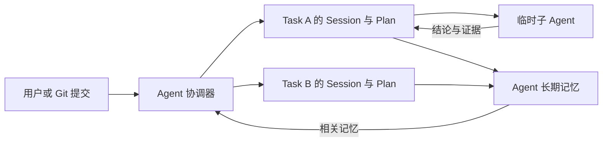

# Agent 怎样持续工作

一个本机 `AgentRuntime` 加载 Agent 的身份、规则、项目与模型。协调器先保存输入，再确定是直接回复、继续旧 Task、创建 Task，还是请求澄清。明确指向 Task 的消息直接投递。不同 Task 可以在同一事件循环等待模型，每个 Task 只有一个 Worker。详细状态供用户按需查看。

| 状态 | 归属与用途 |
|---|---|
| Agent | 身份、规则、项目、协调历史和跨 Task 的长期记忆。不同 Agent 分开读取和保存。 |
| Task 与 Session | Task 保存目标、验收、工作副本、预算、Plan 和当前状态。Task ID 对应唯一业务 Session，保存原始输入、动作、计划及交付证据。 |
| Run 与工具动作 | Run 是一次执行尝试。动作有稳定 ID，按意图、开始、结果顺序持久化，便于识别中断窗口。 |
| 子 Agent | 临时 Run，独立上下文，可按页查询父 Session。子 Agent 做只读调查和建议，沿用父 Task 权限、预算和停止信号。父只收到结论和证据。 |
| Context | 每次调用模型时从当前 Session、Plan 和相关记忆组装。压缩保留完整近期工具调用组，原始记录可查。 |

新输入持久化后，Worker 在下一动作前检查。有新输入时，旧模型结果中的未启动动作会被跳过，在途结果仍保留。执行者用稳定步骤 ID 更新 Plan。完成后收到相关跟进，可以继续原 Task 并保留旧交付。显式变更验收时，更新后的条件用于最终检查。

## 文件、验收与重启

Git 项目使用从已记录提交创建的 worktree，普通目录使用独立副本。模型工具只读写副本内的普通文件，验收器检查文件、内容或静态 Python 语法，保存 SHA-256 和差异。worktree 共享 Git 元数据。首版的 `run_check` 运行注册的内置检查，避免把仓库程序的文件和网络权限交给模型。

执行结果由验证器判定。验证失败会进入有限纠正，无法验证、取消、预算耗尽有各自的状态。SQLite 记录写入前的意图、文件指纹和写入结果。重启时，目标指纹已经匹配就补记结果，原指纹匹配且没有较新的输入才重试。两者均不匹配就等待核对。已主动停止的 Task 保持停止。

## 主动发现与长期记忆

观察器只读项目源仓库的已提交快照。没有新提交时只比较 HEAD。协调器用变化证据和已有 Task 判断是否创建工作，以项目及问题键关联已知工作。瞬时失败有限重试。发现来源只提供项目证据，写入授权取现有项目配置。

Task 通过检查或完成后，运行时异步提炼带来源的经验。Agent 也可按用户明确指令保存偏好。可靠条目生效，冲突或推断保留为候选。按 Agent 和项目相关性召回少量条目。更正保留来源，失效条目归档。删除移除记忆正文和索引，原始 Session 和外部备份各自保留。

从 [runtime.py](../src/demoharness/runtime.py) 到 [core/loop.py](../src/demoharness/core/loop.py) 是当前阅读路径。早期 SDK 与循环分别保留在 `legacy_runtime.py` 和 `core/legacy_loop.py`，供旧示例和回归测试使用。`docs/design/` 保留早期设计记录。[能力规格](specs/agent-feature-scope.md)
