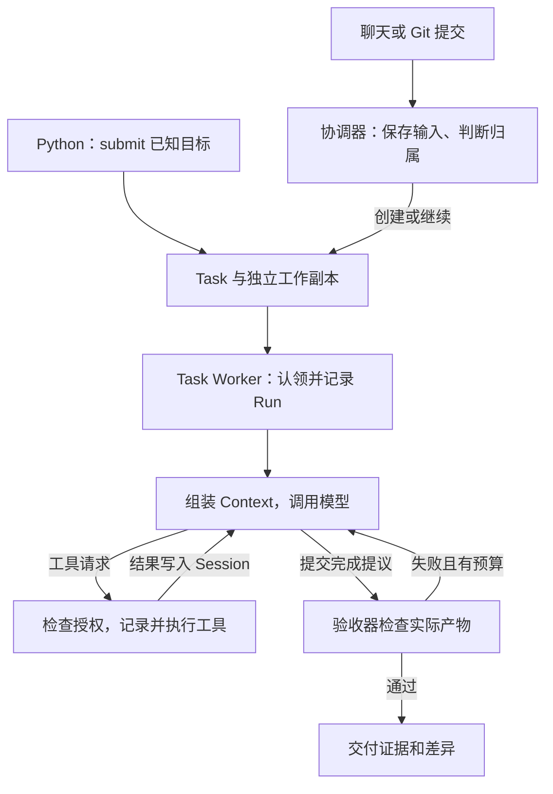

# DemoHarness 系统设计

这份文档统一记录能力范围、架构和实现状态。决定按最后一次明确确认的讨论更新。代码与已确认设计之间的差距记在本文末尾。

DemoHarness 面向一位使用者学习本机 Agent 的执行过程。一个 Python 进程运行多个相互隔离的 Agent，CLI 和 Python API 共用一个运行时及 SQLite 状态库。进程停止期间暂停推进，重启后核对已有结果。首版交付工作副本内的变更和验收证据，由使用者决定如何合入。

## 一次工作怎样完成

以[文件示例](../examples/verified_task.py)为例，目标是生成 `report.md` 并逐字验收。Python 的 `Agent.submit()` 直接提交目标和验收条件。聊天消息或 Git 观察先经协调器，判断是回复、继续已有 Task、创建新 Task，还是请求澄清。

每个 Task 同时最多一个 Worker。A 等模型时，B 可以继续；同一件事的补充落盘后，Worker 会在动作边界读取。已开始动作的结果仍留在历史，过时的待执行动作会跳过。用户明确变更目标或验收后按新条件推进。完成后的明确跟进继续同一个 Task，保留历史和之前的交付。

## 角色和状态归属

| 概念 | 职责 |
|---|---|
| Agent 定义 `AgentDefinition` | 稳定 ID、项目、身份与行为说明、模型及工具授权。CLI 可从 `SOUL.md`、`AGENTS.md` 读取提示。 |
| Agent 运行时 `AgentRuntime` | 本机宿主，打开状态库，装配协调器、观察器、模型和 Worker。 |
| Agent 实例 `Agent` | `runtime.agent(id)` 返回的操作入口。Task、协调记录、工作目录和长期记忆按 Agent ID 隔离。 |
| Task Worker | 推进一个 Task 的协程。运行结束后，Task、Session 和证据继续保存在 SQLite。 |
| Task 与 Session | Task 是一件事，保存目标、验收、状态、预算、Plan 和工作副本。Session 持久记录这件事的输入、工具动作、计划修订及交付。两者一一对应，共用 ID。 |
| Plan | Task 的有序步骤，带版本、稳定步骤 ID、状态和证据引用。Agent 可在约定范围内修订，历史保留变更及原因。 |
| Run 与工具动作 | Run 记录一次执行尝试的 ID、起止和停止原因。同一 Task 可以有多次 Run。工具动作有稳定 ID，便于恢复时核对。 |
| Context | 每次调用模型前按目标、Plan、验收、Session 片段和相关记忆组装。压缩保留完整的近期工具轮次，原始历史可查。 |
| 临时子 Agent | 承接父 Task 的只读调查或改动建议。使用独立上下文，可按页查父 Session。共享父预算和停止信号，回传结论和证据。实例结束后仍能按委派 ID 查看记录。 |
| 长期记忆 | 归 Agent 所有，作用范围可限定到项目。记录偏好、项目事实或约束、可复用经验，并保留来源和时效。 |

协调、Task Worker 与临时委派的分工参考 [DeepSeek Super Agent 的领域模型](https://github.com/deepseek-ai/dsh-superagent-prototype/blob/8c32a9dc5d72c033816c6a8110b37f40cf94fba4/docs/001-domain.md)。协调器判断归属，Task Worker 和子 Agent 共用 `run_loop()`，各自使用适用的工具、上下文和完成条件。

## 执行、验收和恢复

**工作副本与权限。** Git 用已记录提交创建 worktree，普通目录使用独立副本。模型的文件工具受工作根、相对路径和操作权限约束。Task 应在用户授权范围内工作，需要扩大范围时先取得明确授权。当前对副本内部的任务范围仍缺强制检查，见未完成项。任意仓库脚本需要经过验证的隔离执行器，首版提供类型化的文件、文本和静态 Python 语法检查。

**执行与交付。** 宿主给模型、工具、压缩和验收设预算，开始新动作前检查权限、额度和停止信号。模型给出的最终文本进入验收。验收通过才保存完成记录、检查证据和差异，失败可在剩余预算内纠正。无法验收的结果进入等待。主动停止会持久化，重启后保持停止。

**中断恢复。** 工具动作依次记录 `pending`、`started`、`result`。文件写入在开始前保存原指纹和目标指纹，启动时先恢复持久记录，再决定是否推进。

| 中断后看到什么 | 恢复动作 |
|---|---|
| 动作尚未开始 | 检查最新输入、权限和预算，再执行或跳过。 |
| 已有结果，或文件已匹配目标指纹 | 复用结果，或按原动作 ID 补记。 |
| 结果缺失，仍匹配原指纹 | 权限和预算允许、且没有新要求替代旧动作时，可以重试。 |
| 文件与原指纹和目标指纹都不符 | 等待核对。 |

## 记忆与主动发现

阶段检查或完成后，运行时在后台按来源提炼记忆。明确的用户偏好可即时保存。可靠内容可生效，存储层能把推断和冲突保留为候选。召回只选该 Agent 少量相关的有效条目，附上来源和时间。失效条目退出召回并可归档清理，用户可查看、更正和删除记忆。原始 Session 历史有自己的保留边界。

Git 项目默认观察源仓库已提交的快照。启动时读取有限基线，之后根据 HEAD 变化评估，Task 副本的输出不会触发源仓库观察。协调器依据变更和已有工作判断忽略、关联或创建，不要求用户逐条写触发规则。观察以项目和提交去重，新工作以问题键关联。默认观察任务可读取和运行内置检查，写入需要既有项目授权。观察也遵守用户的停止决定。

## 对照源码和验证

| 想看什么 | 源码入口 | 可复现的场景 |
|---|---|---|
| 任务怎样分派和执行 | [运行时](../src/demoharness/runtime.py) · [共用循环](../src/demoharness/core/loop.py) · [文件验收](../src/demoharness/tools/files.py) | `uv run python examples/verified_task.py` |
| 怎样在中断后辨认工具结果 | [TaskStore](../src/demoharness/core/storage.py) · [文件指纹](../src/demoharness/tools/files.py) | `uv run pytest -q tests/test_agent_runtime.py -k crash`，使用 `SIGKILL` |
| 怎样收补充、修订 Plan 和委派 | [协调器](../src/demoharness/coordination.py) · [Plan](../src/demoharness/core/plan.py) · [委派](../src/demoharness/tools/delegation.py) | `uv run pytest -q tests/test_agent_coordination.py tests/test_agent_delegation.py` |
| 怎样投影 Context、召回记忆和发现工作 | [Session 投影](../src/demoharness/core/session.py) · [记忆](../src/demoharness/memory.py) · [Git 观察](../src/demoharness/discovery.py) | `uv run python examples/super_agent_demo.py`，结尾验证正常重启后保留状态 |

Python API 的主要入口是 `AgentRuntime.open()`、`runtime.agent()`，以及 Agent 的 `send()`、`submit()`、`history()`、`stop()` 和 `resume()`。CLI 操作见[示例索引](../examples/README.md)。新状态保存在 `agent.sqlite3`，早期会话树和旧数据库可留在原处。

## 未完成项

| 项目 | 当前状态与完成标准 |
|---|---|
| Task 范围约束 | 已复现超出任务目标的副本内写入仍通过验收。补齐任务级范围及确认机制，在执行和验收时阻止未授权的额外改动。 |
| 长操作并发 | A 等模型时 B 能完成。Git 副本准备和验收仍有同步操作。需要验证长时间文件或 Git 操作期间仍能接收消息、推进其他 Task。 |
| Plan 修订 | 当前有版本和历史。尚缺步骤退役状态和预期版本校验。 |
| 记忆提炼 | 当前后台从通过的检查或交付记录提炼经验，也支持显式保存。还需从 Plan 和 Session 跨任务提炼有来源的项目事实、约束及决策经验。 |
| 主动发现的归并 | 当前按提交和问题键去重。尚缺用交付指纹关联旧任务，以及在同一事务提交建 Task 和观察去向。 |
| 真实模型验收 | 已通过本地 OpenAI 兼容 HTTP 接口验证。尚待用配置好的外部模型跑示例并核对真实产物。 |
