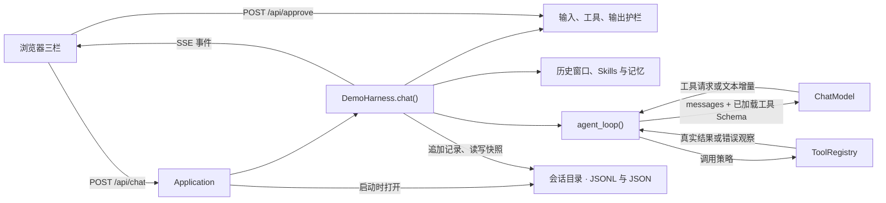

# DemoHarness 架构总览

学习者从浏览器发起一条消息，跟着同一轮的输出观察模型、环境和 Harness 的职责。最小 `agent_loop()` 让模型在可用工具范围内选择动作，把工具结果变成下一次调用的输入。没有工具请求时，模型返回的文本可以作为本轮结果。轮数上限为循环收敛提供保险丝。这个结构参考了 Anthropic 对简单组合、环境真实反馈、人工检查点和停止条件的说明。 [Anthropic · Building effective agents](https://www.anthropic.com/research/building-effective-agents) · [最小循环](../src/demoharness/agent_loop.py)

## 装配和边界

`Application` 做三件事。读取本机配置并打开会话存储，装配模型、工具、护栏和技能，最后提供浏览器界面及 HTTP/SSE 端点。HTTP 入口按会话限制同时运行的对话，审批另走 POST，因此等待审批时流仍然可以接收事件。 [Application](../src/demoharness/application.py)

| 模块 | 负责什么 |
| --- | --- |
| [DemoHarness](../src/demoharness/harness.py) | 串起输入、上下文、执行循环、输出、收尾五个阶段。父 Agent 与 SubAgent 都能复用最小循环。 |
| [工具与协议](../src/demoharness/toolbox.py) | 每个工具用自己的 Schema 和处理策略。搜索发现工具后，下一轮才获得相应 Schema。 |
| [Guardrails](../src/demoharness/guardrails.py) | 拦截输入、验证工具请求、等待用户审批，并检查对外文本。审批的归属按 Session 和审批 ID 核对。 |
| [Store](../src/demoharness/state.py) | 通过原有接口保存会话记录和状态快照，为对话、模型窗口和回放提供读取入口。 |
| [Skills](../src/demoharness/skills.py) | 启动时读取技能目录，向模型展示简短索引，并在命中输入时加载对应全文。 |
| [模型适配](../src/demoharness/models.py) | 离线模型和 OpenAI 兼容模型遵守同一个流式调用接口。 |
| [MCP](../src/demoharness/mcp.py) | 连接本机配置的 stdio 服务，发现并调用远端工具。 |

工具按需注入以 Anthropic Tool Search 的设计为参考。固定的 `tool_search`、`read`、`todo` 初始可用，其他工具的 Schema 随发现结果加入。发现结果只在当前用户轮次生效。父 Agent 的记忆按会话持久化，子 Agent 从独立上下文开始，回传可公开的结果及工具证据。 [Anthropic · Tool search](https://platform.claude.com/docs/en/agents-and-tools/tool-use/tool-search-tool) · [工具与模式](guide.md#chapter-05)

## 会话持久化

每个会话使用 `~/.demoharness/sessions/<会话 ID>/` 下的两个文件。正常写入时，`history.jsonl` 每行追加一条消息（`message`）、回放事件（`event`）或记忆（`memory`）。每行有 `kind`、Unix 时间戳 `at` 和内容 `value`。状态快照 `state.json` 记录 `id`、`title`、`created_at`、`updated_at`、`options`、`context_window` 和 `trusted_commands`。历史压缩用 `save_window()` 更新快照里的模型窗口，原始消息仍可从 JSONL 读取。 [Store](../src/demoharness/state.py)

Store 启动时准备 `sessions/`，创建会话时生成两个文件。它以原子替换更新快照，重开时会丢弃日志末尾未写完的一行。目录锁保证每个状态目录只有一个应用进程写入。指定 `--state-dir` 时，会话文件写入指定目录下的 `sessions/`。 [会话与回放](guide.md#chapter-04)

## 生产化边界

1. 为用户、会话、工具执行容器设置身份和资源隔离。
2. 为命令、网页获取和 MCP 建立系统级沙箱及网络访问策略。
3. 为历史、记忆与审批制定访问、保留、删除和备份规则。
4. 为调用、批准、错误和 Token 成本加入关联日志、追踪和告警。
5. 按模型的 Token 预算设置压缩阈值，评测压缩后能否保留继续任务所需的信息。也要评测真实模型的工具选择、重试和输出守卫。 [演示与生产的压缩规则](guide.md#chapter-08)
6. 为升级、并发、取消和恢复制定可测试的服务级目标。
